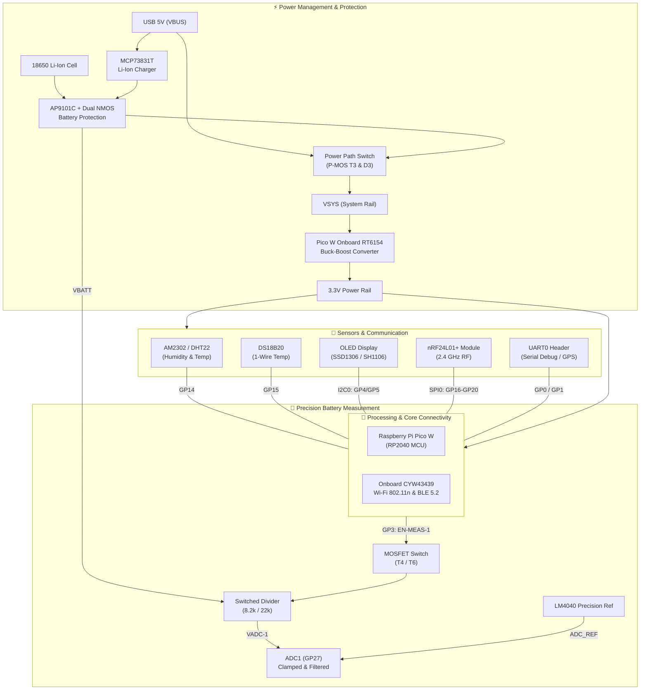
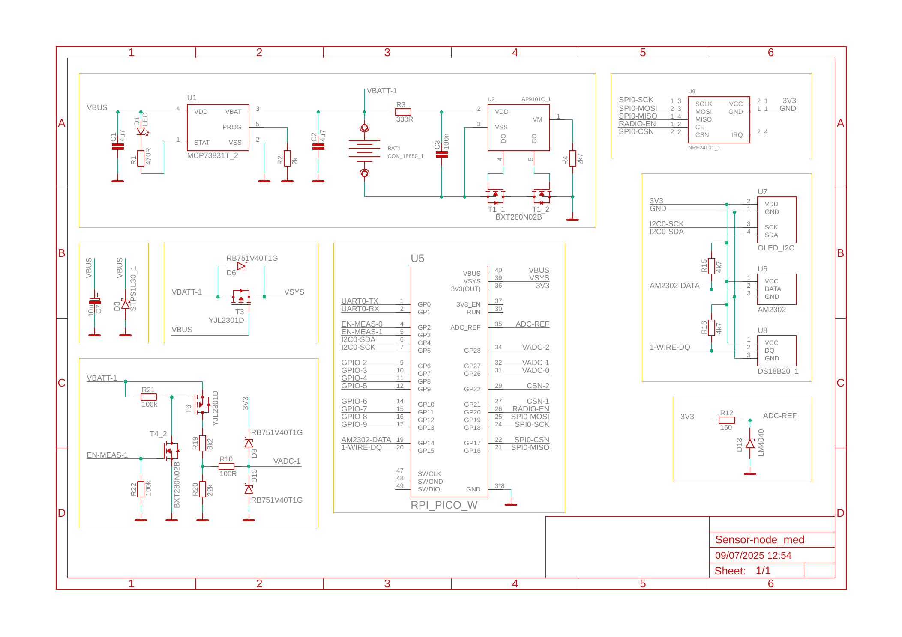

# IoT Sensor Node Medium (`iot-sensor-node-med`)

> Compact, battery-powered wireless IoT environmental monitoring node based on the Raspberry Pi Pico W, featuring Li-Ion charging, hardware battery protection, zero-quiescent voltage monitoring, and multiple sensor/display interfaces.

**Project Status:** Completed & Functional | **Technologies:** Autodesk Eagle, Hardware PCB Design, RP2040 / Pico W, MicroPython / C++

---

## 1. Overview & Key Features

The **IoT Sensor Node Medium** is a dedicated hardware board tailored for low-power remote environmental sensing, smart home telemetry, and weather monitoring. Designed around the **Raspberry Pi Pico W** (RP2040 + CYW43439 Wi-Fi & Bluetooth LE), the board integrates all necessary power management, battery safety circuitry, and sensor interfaces on a compact 49 × 74 mm two-layer PCB.

### Key Highlights
- **Microcontroller:** Raspberry Pi Pico W socket (RP2040 dual-core ARM Cortex-M0+ up to 133 MHz, 264 KB SRAM, 2 MB QSPI Flash, onboard 2.4 GHz 802.11n Wi-Fi and BLE 5.2).
- **Power Architecture:**
  - Standard 18650 Li-Ion / Li-Po single-cell battery holder footprint.
  - **Microchip MCP73831T** linear Li-Ion charge management IC with charging indicator LED (`D1`).
  - **Diodes Inc. AP9101C** dedicated battery protection controller paired with **BXT280N02B** dual N-MOSFET (overcharge, overdischarge cutoff, and short-circuit protection).
  - **Automatic Power Path:** Ultra-low drop P-channel MOSFET (`YJL2301D`) power switch and Schottky diode (`STPS1L30`) automatically transition between USB 5 V (VBUS) and battery power.
- **Ultra-Low Power Battery Monitoring:**
  - **LM4040** precision shunt voltage reference on the RP2040 `ADC_REF` pin for rock-solid ADC measurements regardless of supply variations.
  - Switched resistor divider (8.2 kΩ / 22 kΩ) controlled via GP3 (`EN-MEAS-1`) using dual MOSFETs (`T4` / `T6`). Zero current is consumed by the voltage divider during deep sleep!
  - Analog input clamped with dual Schottky diodes (`RB751V40T1G`) to protect the RP2040 ADC input (`GP27`).
- **Telemetry & Sensor Interfaces:**
  - **AM2302 (DHT22):** Relative humidity and ambient temperature digital sensor on `GP14`.
  - **DS18B20:** 1-Wire high-accuracy digital temperature sensor on `GP15`.
  - **OLED Display Header:** 4-pin header for 0.96" or 1.3" I2C OLED displays (SSD1306 / SH1106) on `I2C0` (`GP4` / `GP5`).
  - **nRF24L01+ 2.4 GHz RF Header:** SPI socket for Nordic nRF24L01+ wireless transceiver module on `SPI0` (`GP16`–`GP20`) for long-range ultra-low-power radio mesh networks.
  - **General Purpose Breakout:** Available headers for `UART0` (TX/RX), additional ADC channels (`GP26`, `GP28`), and multiple digital GPIOs.

---

## 2. Architecture & Block Diagram



---

## 3. Schematic & Circuit Diagram



📄 [Open original high-resolution schematic (PDF)](Sensor-node_med.pdf)

---

## 4. Hardware Specifications & Pin Mapping

### Microcontroller Pin Allocation

| Pico W Pin | Eagle Net Name | Hardware Function / Connected Device | Notes |
| :--- | :--- | :--- | :--- |
| **GP0** | `UART0-TX` | Serial UART TX | Breakout header / Debug |
| **GP1** | `UART0-RX` | Serial UART RX | Breakout header / Debug |
| **GP2** | `EN-MEAS-0` | Auxiliary measurement enable | Reserved / expansion |
| **GP3** | `EN-MEAS-1` | Battery measurement enable | Gates T4 & T6 MOSFETs |
| **GP4** | `I2C0-SDA` | I2C Data bus | Connected to OLED header (pin 4) |
| **GP5** | `I2C0-SCK` | I2C Clock bus | Connected to OLED header (pin 3) |
| **GP6–GP13** | `GPIO-2`..`GPIO-9`| General-purpose digital I/O | Header breakout pins |
| **GP14** | `AM2302-DATA` | AM2302 / DHT22 Data line | Pulled up to 3.3V with 4.7 kΩ (R15) |
| **GP15** | `1-WIRE-DQ` | DS18B20 1-Wire Data line | Pulled up to 3.3V with 4.7 kΩ (R16) |
| **GP16** | `SPI0-MISO` | nRF24L01+ MISO | SPI0 Data in |
| **GP17** | `SPI0-CSN` | nRF24L01+ Chip Select Not | SPI0 CSN |
| **GP18** | `SPI0-SCK` | nRF24L01+ Clock | SPI0 SCK |
| **GP19** | `SPI0-MOSI` | nRF24L01+ MOSI | SPI0 Data out |
| **GP20** | `RADIO-EN` | nRF24L01+ Chip Enable (CE) | Radio TX/RX enable |
| **GP26** | `VADC-0` | ADC Channel 0 | External analog input |
| **GP27** | `VADC-1` | ADC Channel 1 | Switched battery voltage divider input |
| **GP28** | `VADC-2` | ADC Channel 2 | External analog input |
| **ADC_REF** | `ADC-REF` | RP2040 ADC Reference voltage | Tied to LM4040 precision shunt reference |

### Power & Battery Circuit Components

| Component | Part / Package | Value / Function | Description |
| :--- | :--- | :--- | :--- |
| **U1** | MCP73831T-2ACI/OT (SOT-23-5) | Li-Ion Linear Charger | $I_{CHG} = 1000V / R_{PROG} = 1000 / 2\,\text{k}\Omega \approx 500\,\text{mA}$ |
| **U2** | AP9101CA6-ANTRG1 (SOT-26) | Battery Protection IC | Overvoltage, undervoltage cutoff, overcurrent |
| **T1** | BXT280N02B (TSSOP-8) | Dual N-MOSFET (20V, 6A) | Low-side power cutoff switch for AP9101 |
| **T3** | YJL2301D (SOT-23) | P-MOSFET (-20V, -2.8A) | Low-loss automatic power path switch |
| **D3** | STPS1L30 (SMA) | Schottky Diode (30V, 1A) | VBUS reverse protection / power supply |
| **D13** | LM4040AIM3-2.5 or 3.0 (SOT-23) | Shunt Reference | Precision reference voltage for ADC |
| **T4 / T6** | BXT280N02B / YJL2301D | NMOS + PMOS Switch | Gates $V_{BATT}$ divider to prevent sleep discharge |

---

## 5. PCB Design & Physical Dimensions

- **PCB Dimensions:** 48.95 mm × 73.90 mm (1.93" × 2.91")
- **Layer Count:** 2 layers (Top Copper, Bottom Copper)
- **Mounting:** Rounded corners, designed to fit inside standard plastic enclosure or snap-fit 3D-printed housing.
- **Top Side:** Houses the Raspberry Pi Pico W module, OLED display header, nRF24L01+ socket, sensors, and status LEDs.
- **Bottom Side:** Accommodates the single 18650 spring battery clip (`CON_18650`), protection IC, and power path semiconductors.

---

## 6. Repository Structure

```text
.
├── docs/
│   └── images/
│       └── schematic.png  # High-resolution schematic preview (180 DPI)
├── Sensor-node_med.sch    # Autodesk Eagle schematic
├── Sensor-node_med.brd    # Autodesk Eagle PCB layout
├── Sensor-node_med.pdf    # Complete schematic and board PDF documentation
├── Sensor-node_med.dru    # Design rules specification (DRC)
├── Sensor-node_med.scr    # Eagle layer & color setup script
├── .gitignore             # Eagle & OS backup filter
└── README.md              # Project documentation
```

---

## 7. How to Use & Firmware Deployment

### Hardware Assembly & Inspection
1. Inspect PCB solder joints around the SOT-23 and SOT-26 packages (`MCP73831T`, `AP9101C`, MOSFETs).
2. Insert a standard protected or unprotected 18650 cell into the battery clips observing correct polarity.
3. Plug in USB: `D1` will illuminate while charging and extinguish when charging completes.

### Firmware Support
This board is fully compatible with MicroPython, CircuitPython, and C/C++ (Pico SDK / Arduino IDE).
To read the battery voltage with zero idle power draw in MicroPython:

```python
from machine import Pin, ADC
import time

# Enable battery measurement divider
en_meas = Pin(3, Pin.OUT)
adc_bat = ADC(Pin(27))

def read_battery_voltage():
    en_meas.value(1)       # Power on the resistor divider
    time.sleep_us(50)      # Wait for rail stabilization
    raw = adc_bat.read_u16()
    en_meas.value(0)       # Immediately shut down divider to save battery

    # Conversion formula based on 8.2k / 22k divider ratio and reference voltage
    v_measured = (raw / 65535.0) * 3.3
    v_batt = v_measured * (8.2 + 22.0) / 22.0
    return v_batt
```

---

## 8. Relations & Ecosystem Links

This project is part of a modular IoT sensor ecosystem:
- **[`iot-sensor-node-max`](https://github.com/nagyjose/iot-sensor-node-max):** Sister project providing a dual-18650 battery bank, dual independent chargers, dual I2C expansion headers, dual SPI expansion headers, and external ADC input.
- **[`pico-w-iot-nodes`](https://github.com/nagyjose/pico-w-iot-nodes):** MicroPython firmware repository implementing BLE GATT telemetry, MQTT over Wi-Fi, DS18B20 / AM2302 acquisition, and deep sleep cycles.
- **[`ble-sensor-gui`](https://github.com/nagyjose/ble-sensor-gui):** PyQt5 / QML desktop application for real-time visualization of telemetry and sensor feeds.

---

## 9. License & Author

- **Author:** Josef Nagy (`nagyjose`)
- **Design Tool:** Autodesk Eagle v9.x
- **License:** Open Hardware / MIT License
